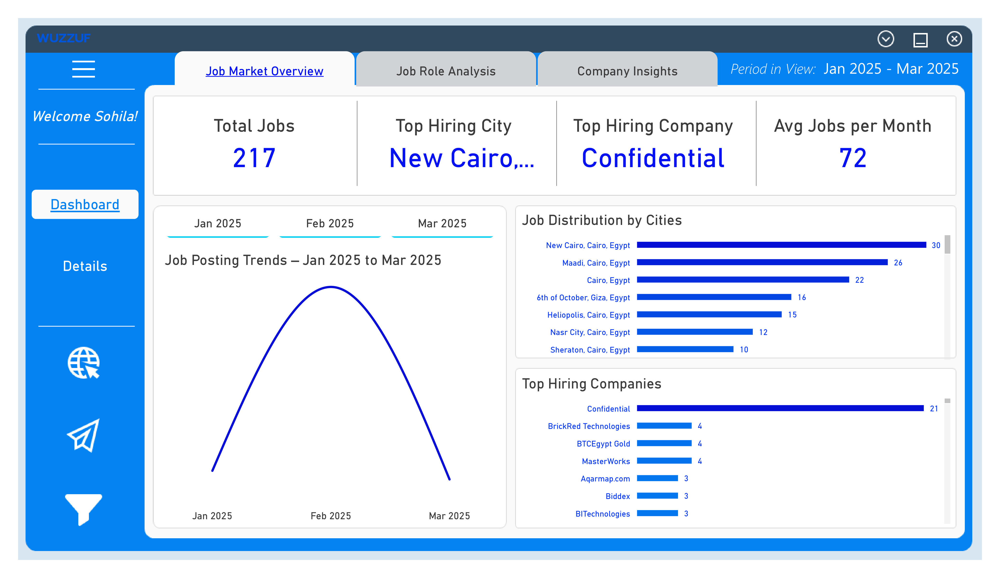
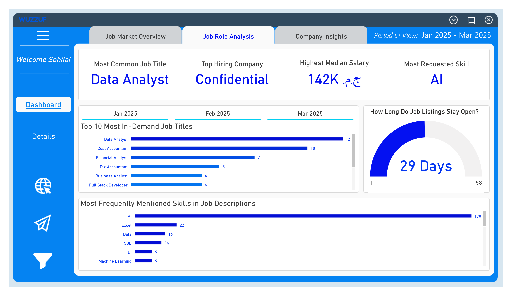
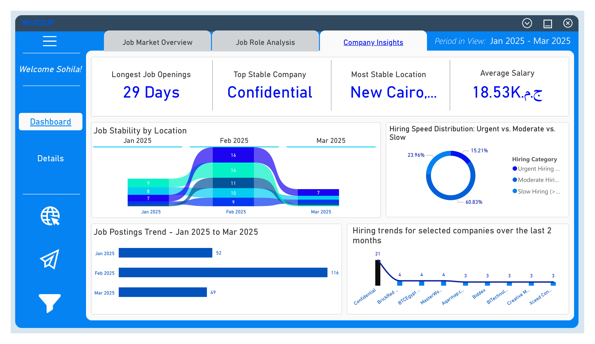
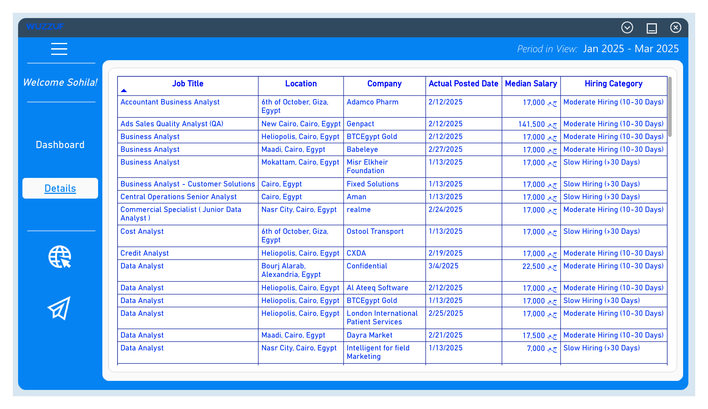

<div align="center">

# Egypt Job Market Analytics
### Wuzzuf Job Market Analysis · Power BI

**Exploring hiring demand, in-demand roles, skills, salaries, and company activity across Egypt.**

<a href="https://app.powerbi.com/view?r=eyJrIjoiMGNjZmFlOWItMWU3My00ZjM4LTlhYjQtMWY5N2QzOGQwMTAyIiwidCI6IjI1Y2UwMjYxLWJiZDYtNDljZC1hMWUyLTU0MjYwODg2ZDE1OSJ9">
  <strong>↗ Open the interactive Power BI report</strong>
</a>
&nbsp;·&nbsp;
<a href="https://sohila-khaled-abbas.vercel.app/work/">Portfolio project collection</a>

<br/>

[](https://github.com/Sohila-Khaled-Abbas/Wuzzuf-Job-Market-Analysis/stargazers)
[](https://github.com/Sohila-Khaled-Abbas/Wuzzuf-Job-Market-Analysis/forks)
[](https://github.com/Sohila-Khaled-Abbas/Wuzzuf-Job-Market-Analysis/commits/main)
[](LICENSE)


</div>

---

## Report preview

The screenshots below are saved report captures from the repository. **Select the main preview or any page image to open the published interactive Power BI report.**

<div align="center">

<a href="https://app.powerbi.com/view?r=eyJrIjoiMGNjZmFlOWItMWU3My00ZjM4LTlhYjQtMWY5N2QzOGQwMTAyIiwidCI6IjI1Y2UwMjYxLWJiZDYtNDljZC1hMWUyLTU0MjYwODg2ZDE1OSJ9">
  
</a>

<sub><strong>01 · Job Market Overview</strong> — headline KPIs, job-posting trends, hiring companies, and geographic distribution. Click the image to open Power BI.</sub>

</div>

| 02 · Job Role Analysis | 03 · Company Insights |
|:---:|:---:|
| <a href="https://app.powerbi.com/view?r=eyJrIjoiMGNjZmFlOWItMWU3My00ZjM4LTlhYjQtMWY5N2QzOGQwMTAyIiwidCI6IjI1Y2UwMjYxLWJiZDYtNDljZC1hMWUyLTU0MjYwODg2ZDE1OSJ9"></a> | <a href="https://app.powerbi.com/view?r=eyJrIjoiMGNjZmFlOWItMWU3My00ZjM4LTlhYjQtMWY5N2QzOGQwMTAyIiwidCI6IjI1Y2UwMjYxLWJiZDYtNDljZC1hMWUyLTU0MjYwODg2ZDE1OSJ9"></a> |
| <sub>Job titles, requested skills, and job-open duration.</sub> | <sub>Company-level hiring trends, job stability, and hiring-speed categories.</sub> |

<div align="center">

<a href="https://app.powerbi.com/view?r=eyJrIjoiMGNjZmFlOWItMWU3My00ZjM4LTlhYjQtMWY5N2QzOGQwMTAyIiwidCI6IjI1Y2UwMjYxLWJiZDYtNDljZC1hMWUyLTU0MjYwODg2ZDE1OSJ9">
  
</a>

<sub><strong>04 · Contextual Details</strong> — detailed view supporting the report's tooltip and drill-down experience.</sub>

<br/><br/>

<a href="https://app.powerbi.com/view?r=eyJrIjoiMGNjZmFlOWItMWU3My00ZjM4LTlhYjQtMWY5N2QzOGQwMTAyIiwidCI6IjI1Y2UwMjYxLWJiZDYtNDljZC1hMWUyLTU0MjYwODg2ZDE1OSJ9">
  <strong>OPEN THE LIVE POWER BI REPORT ↗</strong>
</a>

</div>

> GitHub displays the saved screenshots above. The interactive report is hosted by Power BI and may require an available browser session or report permissions. If the embedded experience is unavailable, use the direct Power BI link.

## Project overview

This project analyzes job advertisements collected from **Wuzzuf**, focusing on the Egyptian job market during **January–March 2025**. Python was used for data collection, the prepared data is supplied as Excel files, and Power BI is used to explore hiring demand and workforce signals through interactive report pages.

The report is designed to help explore questions such as:

- Which job titles appear most frequently in the collected postings?
- Which skills are most commonly requested by employers?
- Where is hiring activity concentrated geographically?
- Which companies and locations show stronger hiring activity?
- What do the available salary and job-duration fields indicate?

## Analytical snapshot

The existing report documents the following headline observations for its dataset and selected report views.

| Indicator | Reported observation |
|---|---:|
| Job postings | **217** |
| Coverage period | **Jan–Mar 2025** |
| Average postings per month | **72** |
| Most common job title | **Data Analyst** |
| Most requested skill | **AI** |
| Top hiring city | **New Cairo** |
| Top hiring company | **Confidential** |
| Highest median salary shown | **142K EGP** |
| Average salary shown | **18.53K EGP** |
| Longest job opening shown | **29 days** |

*These are values documented in the original report overview, not live market statistics. Salary indicators depend on the salary records available in the dataset; missing or undisclosed salary values may not contribute. The repository does not document a refresh schedule or a continuously updating source feed.*

## Dashboard walkthrough

### 01 · Job Market Overview

A high-level view of posting activity and where hiring demand appears.

**Included visuals**
- Job-posting trend across January–March 2025.
- Top hiring companies.
- Geographic distribution of job postings by city.
- KPI cards for total postings and average monthly activity.

### 02 · Job Role Analysis

A closer look at role demand and skills requested in job descriptions.

**Included visuals**
- Top 10 in-demand job titles.
- Extracted-skill frequency analysis.
- Job-open duration analysis.
- Salary comparisons where salary information is available.

### 03 · Company Insights

Company and location comparisons that provide additional context around hiring activity.

**Included visuals**
- Hiring trends for selected companies.
- Job stability by location.
- Hiring-speed distribution:
  - **Urgent:** fewer than 10 days.
  - **Moderate:** 10–30 days.
  - **Slow:** more than 30 days.

### Contextual tooltip pages

The report also includes contextual tooltip views for:
- Top job titles for a selected city.
- Hiring trends for a selected company.
- Job stability details for selected locations.

## Analytical workflow

The repository contains the prepared Excel data extracts and Power BI report file. The original Python collection implementation is not included in the tracked project structure.


## Report capabilities

| Capability | Purpose |
|---|---|
| Interactive slicers | Filter the report by available dimensions such as city, company, or job role |
| DAX measures | Calculate and display report KPIs and analytical measures |
| Dynamic titles | Reflect the selected analytical context |
| Conditional formatting | Emphasize job growth, hiring speed, and salary comparisons |
| Tooltip pages | Add context without navigating away from the main report |
| Geographic visuals | Explore the location distribution of job postings |

## Design system

The original report uses a dark canvas with a blue-focused palette.

| Role | Color |
|---|---|
| Primary | `#0511F2` |
| Accent | `#0460D9` |
| Secondary | `#0583F2` |
| Highlight | `#0468BF` |
| Background | `#0D0D0D` |

Conditional formatting is used for job-growth rates, hiring-speed categories, and salary comparisons.

## Repository structure

```text
Wuzzuf-Job-Market-Analysis/
├── data/
│   ├── wuzzuf_jobs_cleaned.xls
│   └── salaries_table.xls
├── images/
│   ├── page1_overview.png
│   ├── page2_roles.png
│   ├── page3_company.png
│   └── details_page.png
├── report/
│   └── wuzzuf_jobs_dashboard.pbix
├── LICENSE
└── README.md
```

| Asset | Description |
|---|---|
| [Cleaned job dataset](data/wuzzuf_jobs_cleaned.xls) | Prepared job-posting data used by the report |
| [Salary data](data/salaries_table.xls) | Salary-related data extract |
| [Power BI report](report/wuzzuf_jobs_dashboard.pbix) | Editable report file for Power BI Desktop |
| [Overview screenshot](images/page1_overview.png) | Saved report overview |
| [Job roles screenshot](images/page2_roles.png) | Saved job-role analysis |
| [Company screenshot](images/page3_company.png) | Saved company insights |
| [Details screenshot](images/details_page.png) | Saved contextual details view |

## Run the project

1. Clone the repository:

   ```bash
   git clone https://github.com/Sohila-Khaled-Abbas/Wuzzuf-Job-Market-Analysis.git
   cd Wuzzuf-Job-Market-Analysis
   ```

2. Open `report/wuzzuf_jobs_dashboard.pbix` in **Power BI Desktop**.
3. If Power BI requests a source location, point the data source to the corresponding Excel file under `data/` and refresh the model.
4. Use the slicers, filters, and tooltip interactions to explore the available report views.

**To inspect the published version:** [Open the interactive report in Power BI](https://app.powerbi.com/view?r=eyJrIjoiMGNjZmFlOWItMWU3My00ZjM4LTlhYjQtMWY5N2QzOGQwMTAyIiwidCI6IjI1Y2UwMjYxLWJiZDYtNDljZC1hMWUyLTU0MjYwODg2ZDE1OSJ9).

## Project scope and limitations

- The analysis reflects the repository's January–March 2025 dataset snapshot.
- The tracked repository contains prepared Excel extracts and a Power BI report; it does not currently include the original Python scraping source code.
- The README does not establish that the source data refreshes automatically.
- Salary findings should be interpreted in light of incomplete or undisclosed salary information.
- A Power BI report link is provided, but its availability and access settings are controlled by Power BI.

## About

**Sohila Khaled Abbas**  
Data Analyst · BI Developer · Analytics Engineer

This project is part of my portfolio exploring how data preparation, analytical modeling, and business intelligence can turn raw information into decision-ready reporting.

[Portfolio](https://sohila-khaled-abbas.vercel.app/work/) · [GitHub](https://github.com/Sohila-Khaled-Abbas) · [LinkedIn](https://www.linkedin.com/in/sohilakabbas/)

---

**License:** This project is available under the [MIT License](LICENSE).
